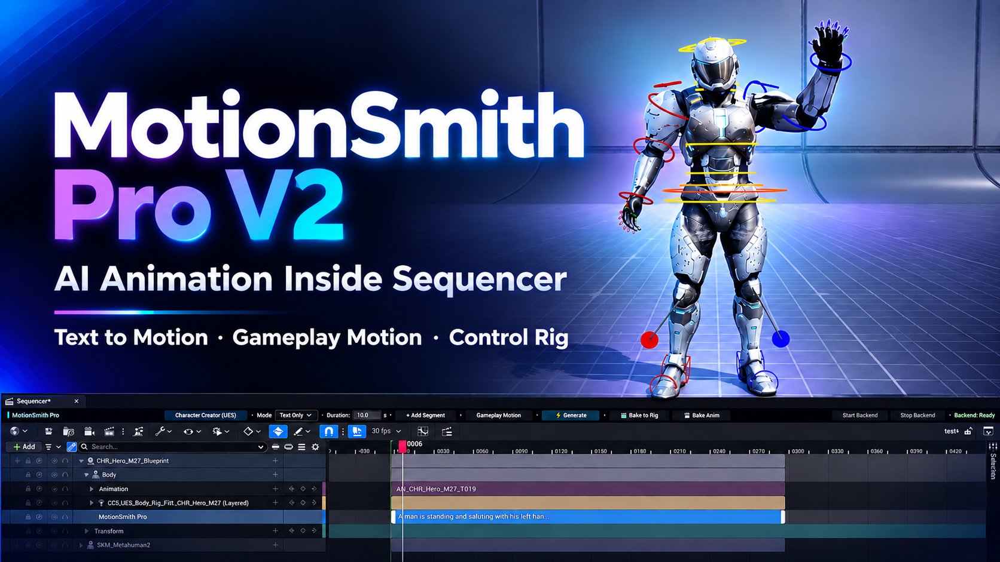

# MotionSmith Pro V2
### AI Text-to-Motion for Unreal Engine Sequencer

**Describe the action. Shape the route. Refine the performance.**

MotionSmith Pro V2 brings prompt-driven character animation into **Unreal Engine 5.8 Sequencer**. Generate motion from text, build route-aware gameplay movement, and refine the result with Control Rig — inside the same sequence as your cameras, lights, and shot timing.

**[Get MotionSmith Pro V2 on Fab](https://www.fab.com/listings/3d83439b-d1b1-4345-865e-08ed69b995b2)** · [Product page](https://motionsmithai.blogspot.com/p/motionsmith-pro-v2.html) · [Documentation](https://motionsmithai.blogspot.com/p/motionsmith-docs-v2.html)

## Watch MotionSmith Pro V2

**[▶ Watch the full video on YouTube](https://www.youtube.com/watch?v=ptCTMbEFt-Q)**

## What you can create

- **Text-to-motion animation:** Describe a character action and generate motion with NVIDIA Kimodo.
- **Gameplay Motion:** Assemble supported locomotion and gameplay actions from prepared animation assets, with Kimodo generation available when needed.
- **Spline-driven routes:** Author the movement path in the level and keep the character aligned with the route and traversable ground.
- **Sequencer prompt sections:** Direct individual motion segments alongside the rest of your shot.
- **Segment continuation:** Extend a performance with another motion beat instead of rebuilding the whole sequence.
- **Control Rig refinement:** Polish the generated performance directly in Sequencer.
- **Character workflows:** Work with UE5 Manny / Quinn and supported MetaHuman setups.

## From prompt to performance

1. **Prepare your character** in a Level Sequence.
2. **Describe the action** and author a route when the shot needs one.
3. **Build the motion segment** with Gameplay Motion or Kimodo generation.
4. **Continue and refine** the performance with additional segments, timing edits, and Control Rig.

## Get started

1. Get the plugin from **[Fab](https://www.fab.com/listings/3d83439b-d1b1-4345-865e-08ed69b995b2)**.
2. Follow the **[installation guide](https://motionsmithai.blogspot.com/p/motionsmith-docs-v2.html#installation)** for Unreal Engine 5.8.
3. Complete the **[Quick Start](https://motionsmithai.blogspot.com/p/motionsmith-docs-v2.html#quick-start)** and create your first shot.

The workflow targets the **Windows 64-bit Unreal Editor**. AI generation uses a separate **[MotionSmith Runtime](https://huggingface.co/Serqan/MotionSmith-Runtime)** and an NVIDIA CUDA GPU. Runtime and model setup, supported characters, and full hardware requirements are covered in the [documentation](https://motionsmithai.blogspot.com/p/motionsmith-docs-v2.html#requirements).

Gameplay Motion uses animation content from Epic's **Game Animation Sample**, installed separately. Meta Llama 3 model access and licensing are handled separately during runtime setup.

## Links

- **Plugin:** [MotionSmith Pro V2 on Fab](https://www.fab.com/listings/3d83439b-d1b1-4345-865e-08ed69b995b2)
- **Documentation:** [Setup, workflow, and troubleshooting](https://motionsmithai.blogspot.com/p/motionsmith-docs-v2.html)
- **YouTube:** [MotionSmith AI](https://www.youtube.com/@motionsmithai)
- **Support:** [MotionSmith Support](https://motionsmithai.blogspot.com/p/support.html)
